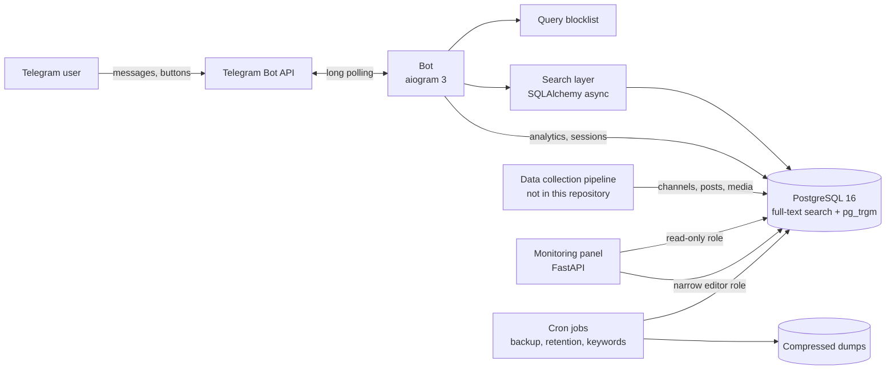

# TeleSeek

Full-text search engine for Telegram channels, groups and posts, delivered as a Telegram bot.

> Solo-built, from architecture to production. This repository contains the bot, the search layer, the database schema, the monitoring panel and the deployment setup. Data collection is described in [docs/data-pipeline.md](docs/data-pipeline.md); its code is not part of this repository.

**Live bot:** https://t.me/TeleSeekSearch_bot

## Key numbers

| Metric | Value |
|---|---|
| Indexed posts | 5.2 million |
| Indexed sources | 27.5K (17K channels + 10.5K groups) |
| Peak parallel collection workers | 18 |
| Search languages | full stemming: English, Russian; prefix matching: Uzbek, Kazakh; exact-form matching: Arabic; fuzzy matching on channel names |
| Bot interface languages | English, Russian |
| Worst-case search time | 92 s → 3.3 s (measured on production data) |
| Load | ~218 search queries per day (30-day average) |

_As of: October 2026_

## What it does

- Full-text search across channels, groups and posts, with filters by content type (channels, groups, posts, photos, videos, audio, documents) and three sort orders (relevance, views, date)
- Multilingual search: stemming for English and Russian, prefix matching for agglutinative Uzbek and Kazakh, exact-form matching for Arabic, typo-tolerant lookup of channel names
- Channels are also found by the topic of their posts (keywords built from post statistics)
- Exact duplicate posts (reposts of the same text) are hidden from results
- Content moderation: a query blocklist checked before any database access, and a content filter (safe search by default, 18+ flag per channel with a manual labelling editor)
- Web monitoring panel: database and ingestion metrics, search demand, channel labelling, user feedback, usage limits
- Daily backups, retention jobs and schema migrations

## Architecture



More detail: [docs/architecture.md](docs/architecture.md)

## Tech stack

Python 3.11, aiogram 3, PostgreSQL 16 (full-text search, pg_trgm), SQLAlchemy 2 (async, asyncpg), Alembic, FastAPI (monitoring panel), Docker Compose, pytest. The collection pipeline used Telethon.

## How search works

Channel and post texts are indexed into weighted `tsvector` columns maintained by database triggers (channel title > description > category and topic keywords; first 200 characters of a post > the rest). A query is normalised with the same text-search configuration as the index, so English and Russian words are stemmed and other scripts match by exact form. When exact matching returns less than a page, a prefix fallback (`lexeme:*`) catches the suffixes of agglutinative languages such as Uzbek and Kazakh. Channel lookups then fall back to a substring match and finally to trigram similarity on titles and usernames, which tolerates typos. The substring fallback over posts runs under a 2-second time budget, so a rare word can no longer turn into a minute-long scan. Details: [docs/search.md](docs/search.md)

## Performance

The slowest search path — a substring scan over millions of posts that ran when full-text search found nothing — took up to 92 s. Putting that fallback under a time budget brought the worst measured case to 3.3 s, with the result sets of successful queries unchanged. What the problem was, what changed and how it was measured: [docs/performance.md](docs/performance.md)

## Data pipeline

The index was built by a multi-account collection service: a dispatcher process distributed a shared queue of channels between up to 18 parallel workers, each with its own Telegram client session. Rate limits were handled with per-round lookup budgets and cached channel handles; failures were classified into account, network, database and per-channel errors, with automatic restarts and redistribution of work. Details: [docs/data-pipeline.md](docs/data-pipeline.md)

## Quick start

The demo runs on synthetic data only and does not need a Telegram token.

```bash
git clone https://github.com/folivia00/teleseek.git
cd teleseek
cp .env.example .env        # placeholder values are enough for the demo
docker compose up -d --build
```

This starts PostgreSQL, applies the migration, creates the panel's database roles, loads a small synthetic data set and starts the monitoring panel at http://127.0.0.1:18090. Without `BOT_TOKEN` the bot container exits with a hint; everything else works.

Try the search from the command line — it runs exactly the same code as the bot:

```bash
docker compose run --rm bot python -m scripts.search_cli "recipe"
docker compose run --rm bot python -m scripts.search_cli "рецепт"            # Russian stemming
docker compose run --rm bot python -m scripts.search_cli "yangilik"          # Uzbek, prefix matching
docker compose run --rm bot python -m scripts.search_cli "жаңалық"           # Kazakh, prefix matching
docker compose run --rm bot python -m scripts.search_cli "وصفات"             # Arabic, exact word form
docker compose run --rm bot python -m scripts.search_cli "tecnology digest"  # typo in a channel name
docker compose run --rm bot python -m scripts.search_cli "news" --type posts --page 2
docker compose run --rm bot python -m scripts.search_cli "travel" --type photos --sort v
```

Demo data and tests intentionally contain Russian, Kazakh and Arabic text to exercise multilingual search.

To run the bot in Telegram, create a test bot with [@BotFather](https://t.me/BotFather), set `BOT_TOKEN` in `.env` and run `docker compose up -d bot`.

## Project structure

```
teleseek/
├── bot/                    Telegram bot (aiogram 3)
│   ├── database/           models, connection, search queries
│   ├── handlers/           /start, search, feedback, admin
│   ├── keyboards/          inline and reply keyboards
│   ├── middlewares/        DB session, user analytics
│   ├── services/           search engine, result formatter
│   ├── i18n.py             interface texts (EN/RU)
│   ├── limits.py           usage limits and premium
│   └── safety.py           query blocklist
├── migrations/             Alembic (baseline schema)
├── panel/                  monitoring panel (FastAPI + HTML dashboard)
├── scripts/                demo data, search CLI, roles, maintenance, cron jobs
├── tests/
│   ├── unit/               no database
│   └── integration/        against the compose database
├── docs/                   architecture, search, pipeline, performance, deployment, operations
├── docker-compose.yml
├── Dockerfile
└── .env.example
```

## Documentation

- [Architecture](docs/architecture.md)
- [Search](docs/search.md)
- [Data pipeline](docs/data-pipeline.md)
- [Performance](docs/performance.md)
- [Deployment](docs/deployment.md)
- [Operations](docs/operations.md)

## Testing

```bash
# unit + integration tests against the compose database (synthetic data)
docker compose --profile test run --rm tests

# unit tests only, no database
pip install -r requirements-dev.txt && python -m pytest tests/unit
```

## License

[MIT](LICENSE)

## Contact

**Vladimir K.**, Python developer: Telegram bots, search, data pipelines.

- Upwork: https://www.upwork.com/freelancers/~01944470ea8eacd678
- Freelancer: https://www.freelancer.com/u/sngmu
