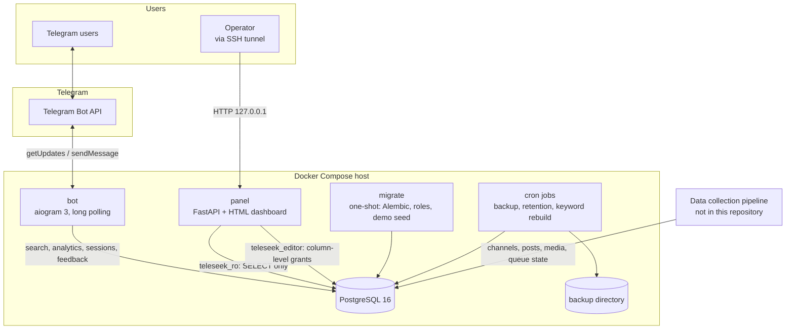
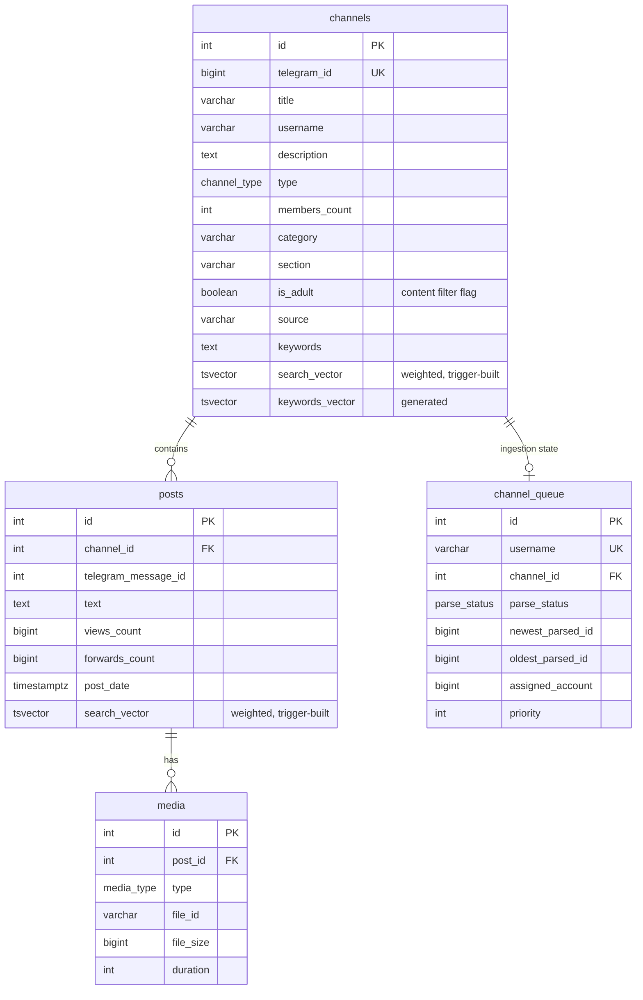

# Architecture

TeleSeek is a set of small services around one PostgreSQL database. The bot and
the monitoring panel read and write the database directly; there is no separate
API layer between them. The data-collection pipeline that filled the index wrote
into the same database (see [data-pipeline.md](data-pipeline.md)).

## Components

| Component | Role |
|---|---|
| `bot` | Receives updates by long polling, runs the query blocklist, calls the search layer, formats results, keeps per-user search sessions and analytics. |
| Search layer (`bot/database/queries.py`, `bot/services/search_engine.py`) | Builds the full-text, prefix, substring and trigram queries; ranking, sorting, deduplication, pagination. |
| `panel` | Monitoring dashboard and a few operator tools. Separate image and dependencies; talks to the database through two restricted roles. |
| `migrate` | One-shot job: `alembic upgrade head`, role setup, optional demo data. |
| PostgreSQL | Stores everything and does the search work (GIN indexes on `tsvector`, `pg_trgm`). |
| Cron jobs (`scripts/cron/`) | Daily compressed dump with rotation, cleanup of stale search sessions, telemetry retention, rebuild of channel topic keywords. |

## Request flow inside the bot

1. **Middlewares.** A database session is opened per update. User analytics
   (`user_stats`) is written in its *own* short transaction, so a slow search
   never holds the user's row lock (see [performance.md](performance.md)).
2. **Blocklist.** `bot/safety.py` normalises the query and checks it against the
   blocklist before any database access; a blocked query is answered with a
   neutral message and its text is never logged.
3. **Search.** `SearchEngine` runs the query for the selected content type, sort
   order and content-filter mode (see [search.md](search.md)).
4. **Session.** The result message is registered as the user's active search
   session; buttons on older result messages stop working instead of acting on
   stale state.
5. **Logging.** The normalised query, result count and filter mode go to
   `search_log` (demand analytics for the panel).

## Data model

The content tables and their relations. `search_vector` columns are maintained
by triggers; `keywords_vector` is a generated column.

User-facing tables (no foreign keys; linked by `telegram_user_id`):

| Table | Key columns | Purpose |
|---|---|---|
| `search_log` | `telegram_user_id`, `query`, `results_count`, `has_results`, `adult_only`, `created_at` | demand analytics, zero-result queries |
| `user_stats` | `telegram_user_id` (unique), `requests_count`, `language`, `last_seen` | audience, interface language |
| `search_session` | `telegram_user_id`, `chat_id`, `message_id` (unique per chat) | the user's active result message |
| `feedback` | `telegram_user_id`, `text`, `is_favorite` | feedback sent from the bot |
| `user_subscription` | `telegram_user_id`, `tier`, `status`, `expires_at` | manual premium access |
| `app_settings` | `key` (PK), `value` | limits configuration read by the bot |

Other tables: `channel_access` (per-account channel handle cache used by the
pipeline), `channel_edit_log` and `admin_action_log` (audit logs of panel edits),
`interaction_log` (paging/filter telemetry with retention), `hot_searches`
(legacy, no longer written).

Constraints that matter for correctness:

- `posts (channel_id, telegram_message_id)` is unique, so re-collecting a channel
  updates rows instead of duplicating them.
- `views_count`, `forwards_count` and `media.file_size` are `BIGINT`: viral
  counters and large files overflow 32-bit integers.
- The full schema lives in a single Alembic migration
  (`migrations/versions/0001_baseline_schema.py`); the bot never calls
  `create_all`, because the search triggers exist only in the migration.

## Access control

| Role | Used by | Rights |
|---|---|---|
| owner (`POSTGRES_USER`) | bot, migrations, cron jobs | full |
| `teleseek_ro` | panel (dashboard, analytics) | `SELECT` on all tables, `default_transaction_read_only = on` |
| `teleseek_editor` | panel write actions | `UPDATE (is_adult, category)` on `channels`; insert into the edit log; favourite/delete on `feedback`; limits and premium tables through column-level grants |

The editor role cannot touch posts or any other channel column even if the
panel code had a bug: the restriction is enforced by the database.
