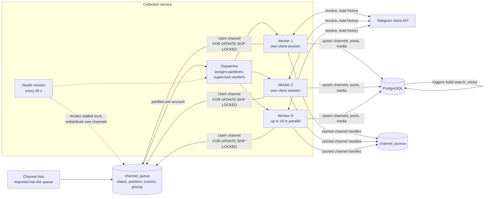

# Data pipeline

The index was built by a separate collection service that read public Telegram
channels through the Telegram client API and wrote channels, posts and media into
the shared PostgreSQL database. **Its code is not part of this repository**; this
document describes how it was designed. The bot and the panel in this repository
only depend on the database tables it filled (`channels`, `posts`, `media`,
`channel_queue`, `channel_access`).

## Overview

## Queue and partitions

- Every channel to collect is a row in `channel_queue` with a status (`new`,
  `in_progress`, `done_depth`, `error`, `restricted_skip`), two cursors
  (`newest_parsed_id`, `oldest_parsed_id`) and an optional priority.
- The dispatcher split the queue into **partitions**: each channel was pinned to
  one worker account (`assigned_account`). Assignment only filled unassigned
  rows, so restarting the service did not reshuffle work, and each account kept
  the channels whose handles it had already cached.
- A worker **claimed** a channel with `SELECT … FOR UPDATE SKIP LOCKED`, so two
  workers could never process the same channel. Together with the unique
  constraint on `posts (channel_id, telegram_message_id)` this kept duplicates at
  zero.

## A collection round

Workers ran continuous rounds over their partition. For each channel:

1. **Resolve** the channel (or reuse the cached handle from `channel_access`).
2. **Catch up**: read messages newer than `newest_parsed_id`.
3. **Deepen**: read older history below `oldest_parsed_id`, up to a per-channel
   depth limit, after which the channel was marked `done_depth` and only caught up
   on later rounds.
4. **Write** posts and media with upserts (`ON CONFLICT DO UPDATE`), so
   re-reading a message refreshed counters instead of creating a duplicate.

The search vectors were built by database triggers, so the collector never
contained any indexing logic.

## Rate limits

- **Lookup budget.** Resolving a channel by username was the most rate-limited
  operation, so each round allowed only a fixed number of *new* lookups
  (15 by default) per worker; already resolved channels were served from the
  per-account handle cache.
- **Flood waits.** Short waits were absorbed by the client automatically; long
  ones put the worker into a `floodwait` state until the deadline, while it kept
  working on channels whose handles were already cached.
- **Priority.** A one-off priority boost let an operator collect a specific set
  of channels first without changing the rest of the queue.

## Failure handling and recovery

A single error classifier was shared by the dispatcher and the per-channel code:

| Class | Examples | Reaction |
|---|---|---|
| Fatal for the account | authorisation revoked, account deactivated or banned | the worker stops (`dead`); its partition is reclaimed and redistributed; the account needs manual replacement |
| Transport | connection reset, timeouts, network route unavailable | the worker restarts with exponential backoff; the account is **not** considered dead |
| Database transient | database restart, closed connection | reconnect and continue; never treated as an account failure |
| Per channel | invalid username, private or removed channel | the channel goes to `error` (or `restricted_skip`); the worker continues |

Recovery mechanisms:

- **Supervised health monitor.** Every 30 seconds it logged the state of every
  worker, reclaimed channels from workers that had stopped sending heartbeats,
  and distributed newly imported channels to running workers. The monitor itself
  ran under a supervisor; silence for more than three minutes counted as a
  failure.
- **Reclaim limits.** A worker stuck in a transport failure for too long lost
  its partition to working workers, so a single broken route did not stall a
  share of the queue.
- **Per-channel timeout.** A single slow channel could not block a worker.
- **Fail-closed networking.** Each worker had its own dedicated network route;
  if the route could not be verified, the worker waited instead of connecting
  without it.
- **Disk guard.** Deepening history stopped at a disk-usage threshold and all
  collection paused at a higher one.

## Sessions and accounts

Each worker owned exactly one Telegram client session and one network route;
sessions were never shared between processes. Account lifecycle was explicit:
a new account was onboarded and verified before joining the pool; a dead
session was detected by the classifier, its channels were redistributed, and the
account was replaced by an operator. Peak capacity was **18 parallel workers**.

## Other sources

- **Public web previews.** Channel and group metadata (title, description,
  subscriber count) was read from public preview pages. Groups were indexed this
  way as searchable cards without posts (`source = 'group'`, `'web'`).
- **External import.** Channels that the client API does not serve to
  non-subscribed accounts were imported from an external data provider. The
  import was idempotent, used the same upsert keys and marked its rows in the
  `source` column.

## Testing approach

The dispatcher was developed against a regression bench with mocked Telegram
clients and an isolated database. Scenarios covered load (pool freezes, stalled
partitions, long flood waits), hard failures (network storms, monitor crash,
restarts under load, cancellation mid-write), account death, adding workers and
database restarts. The invariants checked on every run: zero duplicate posts, no
async-context errors, no cascading failures.
