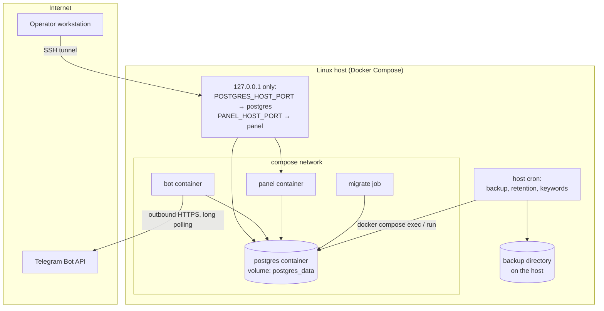

# Deployment

TeleSeek runs as a Docker Compose stack on a single Linux host. Production used
the same `docker-compose.yml` as the demo, with real values in `.env` and the
PostgreSQL tuning variables raised to match the server size.

## Topology



- The bot needs only **outbound** HTTPS to Telegram: it uses long polling, so no
  inbound port or webhook endpoint is required.
- PostgreSQL, the panel and the optional Adminer are published on `127.0.0.1`
  only (default host ports 15432, 18090 and 18080). Operators reach them through
  an SSH tunnel, for example `ssh -L 18090:127.0.0.1:18090 user@server` and then
  `http://localhost:18090`.
- Every container has a memory limit; PostgreSQL has its own cgroup so a runaway
  process elsewhere cannot make it the first OOM victim.

## First start

```bash
git clone https://github.com/folivia00/teleseek.git
cd teleseek
cp .env.example .env
# edit .env: BOT_TOKEN, POSTGRES_PASSWORD, POSTGRES_RO_PASSWORD,
# POSTGRES_EDITOR_PASSWORD, ADMIN_IDS; DEMO_SEED=0 for a real installation
docker compose up -d --build
```

Start order is enforced by Compose:

1. `postgres` starts and becomes healthy (`pg_isready`).
2. `migrate` runs once: `alembic upgrade head`, then `scripts/setup_roles.py`
   (creates or updates `teleseek_ro` and `teleseek_editor` with passwords from
   `.env`), then — only if `DEMO_SEED=1` — the synthetic seed and the keyword
   build. The seed refuses to run on a database that already has channels.
3. `bot` and `panel` start after `migrate` has completed successfully.

Without `BOT_TOKEN` the bot container prints a hint and exits with code 0, so the
rest of the stack (database, panel, command-line search) can be used without
Telegram.

## Configuration

All settings are environment variables. `.env.example` lists every variable with
a placeholder value and a comment. The groups:

| Group | Variables |
|---|---|
| Bot | `BOT_TOKEN`, `BOT_NAME`, `BOT_PUBLIC_USERNAME`, `ADMIN_IDS`, `SEARCH_RESULTS_PER_PAGE`, `MAX_QUERY_LENGTH` |
| Database | `POSTGRES_DB`, `POSTGRES_USER`, `POSTGRES_PASSWORD`, `POSTGRES_RO_PASSWORD`, `POSTGRES_EDITOR_PASSWORD`, `DATABASE_URL` |
| Search | `MAX_RESULTS`, `HIDDEN_SECTIONS`, `POST_ILIKE_FALLBACK`, `POST_FALLBACK_TIMEOUT_MS`, `POST_FALLBACK_MAX_RESULTS`, `PREFIX_FALLBACK_THRESHOLD`, `TRGM_TITLE_WS`, `TRGM_USERNAME_SIM` |
| PostgreSQL tuning | `PG_MEM_LIMIT`, `PG_SHM_SIZE`, `PG_SHARED_BUFFERS`, `PG_EFFECTIVE_CACHE`, `PG_WORK_MEM`, `PG_MAINTENANCE_WORK_MEM`, `PG_MAX_CONNECTIONS`, `PG_PRELOAD` |
| Panel | `PANEL_*` cache TTLs and snapshot settings, `ALERT_*` thresholds |
| Ports | `POSTGRES_HOST_PORT`, `PANEL_HOST_PORT`, `ADMINER_HOST_PORT` (all bound to 127.0.0.1) |
| Demo | `DEMO_SEED`, `SEED_CONFIRM` |

The default PostgreSQL tuning suits a 2 GB machine. On a larger server raise
`PG_MEM_LIMIT`, `PG_SHARED_BUFFERS` and `PG_EFFECTIVE_CACHE` so that the search
working set fits in shared buffers, and raise `PG_SHM_SIZE` together with
`PG_WORK_MEM` (parallel hash joins allocate shared memory from `/dev/shm`).

## Updating

```bash
git pull
docker compose build bot panel
docker compose up -d --no-deps --force-recreate migrate   # applies new migrations
docker compose up -d --no-deps --force-recreate bot panel
```

Database changes are made only through Alembic migrations; the search triggers
exist only there.

## Images

| Image | Contents |
|---|---|
| `teleseek-bot` | Python 3.11 slim, bot, migrations and scripts; runs as an unprivileged user. Built with `INSTALL_DEV=1` (the `tests` profile) it also contains pytest. |
| `teleseek-panel` | Python 3.11 slim, FastAPI app only — separate dependencies and build context. |

`.dockerignore` excludes `.env` files, backups, dumps and logs, so neither
secrets nor user data end up in an image layer.
