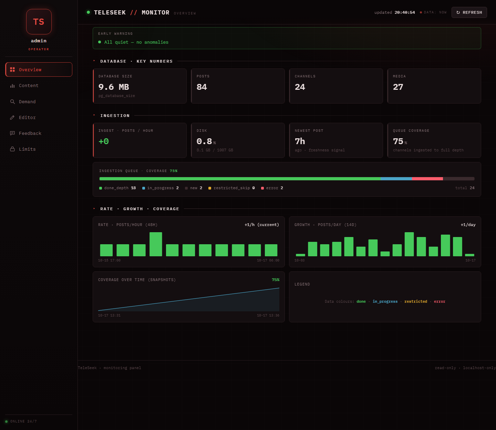

# Operations

## Backups

`scripts/cron/backup_db.sh` makes a daily compressed dump:

- `pg_dump -Fc --no-owner --no-privileges` runs inside the postgres container and
  is streamed to the host; it reads a consistent snapshot without blocking writes;
- the dump is written to a `.part` file and renamed only on success;
- file mode `600` (the dump contains user data), the newest 7 dumps are kept;
- `flock` prevents overlapping runs, and a warning is logged when free disk space
  is low.

Restore into an empty database:

```bash
docker compose exec -T postgres sh -c \
  'pg_restore -U "$POSTGRES_USER" -d "$POSTGRES_DB" --no-owner --clean --if-exists' \
  < backups/teleseek_YYYY-MM-DD_HHMM.dump
docker compose run --rm migrate python -m scripts.setup_roles   # re-create role grants
```

## Scheduled jobs

All jobs read their settings from the environment (`TELESEEK_DIR` is required)
and take a lock so a slow run never overlaps the next one. Example crontab (UTC):

```cron
30 0 * * *  TELESEEK_DIR=/srv/teleseek /srv/teleseek/scripts/cron/refresh_keywords.sh
30 2 * * *  TELESEEK_DIR=/srv/teleseek /srv/teleseek/scripts/cron/backup_db.sh
30 3 * * *  TELESEEK_DIR=/srv/teleseek /srv/teleseek/scripts/cron/cleanup_sessions.sh
0  4 * * 0  TELESEEK_DIR=/srv/teleseek /srv/teleseek/scripts/cron/cleanup_interactions.sh
```

| Job | What it does |
|---|---|
| `refresh_keywords.sh` | Rebuilds channel topic keywords so new channels are found by the topic of their posts. |
| `backup_db.sh` | Daily dump with rotation (above). Scheduled in the low-traffic window. |
| `cleanup_sessions.sh` | Keeps only the latest search session per user (the active result message); never touches analytics tables. |
| `cleanup_interactions.sh` | Deletes interaction telemetry older than 180 days (`INTERACTION_RETENTION_DAYS`). |

## Monitoring

The panel (`http://127.0.0.1:18090` in the demo, through an SSH tunnel on a
server) shows:

- **Overview:** database size, posts/channels/media counts, ingestion rate and
  freshness of the newest post, disk usage, ingestion queue coverage, hourly and
  daily charts, coverage over time (from the panel's own snapshot history);
- **alerts:** ingestion rate dropping below a fraction of its hourly average, and
  a high number of errors in the ingestion queue;
- **Content:** media types, coverage by category, a rough ingestion forecast;
- **Demand:** users, searches per day, share of zero-result queries, top queries
  and top zero-result queries (content gaps), a chronological query feed.
  Admin ids (`ADMIN_IDS`) are excluded from these numbers.



Metrics are served from a TTL cache and the UI always shows the age of the data,
so an old number is never mistaken for a live one. `GET /healthz` is a liveness
probe.

Logs go to the Docker `json-file` driver with size rotation
(`docker compose logs bot`).

## Moderation

- **Query blocklist** (`bot/safety.py`). Queries are normalised (case, separators,
  digit substitutions, Cyrillic homoglyphs, repeated characters, Unicode
  compatibility forms, Arabic diacritics/letter variants/article) and checked
  before any database access. A blocked query gets a neutral reply; only the fact
  is stored in `search_log`, never the text. The term lists in this repository are
  a neutral demo set; real lists are kept outside the code base.
- **Content filter.** Safe search is the default; an 18+ mode shows only flagged
  channels. The panel's labelling editor changes the flag or the category of one
  channel at a time through the narrow `teleseek_editor` role, and every change is
  written to `channel_edit_log` with the old and new value.
- **Regional result filter.** `HIDDEN_SECTIONS` hides channels of the listed
  sections from all results without deleting data. Takes effect after a bot
  restart.
- **Feedback.** Users send feedback from the bot (rate-limited to one message per
  hour, blocklist applied). The panel shows the feed, marks favourites and deletes
  entries.
- **Limits and premium.** Daily search limits and page limits for free users are
  stored in `app_settings` and can be changed in the panel; the bot picks the new
  values up within 60 seconds without a restart. Limits are disabled by default.
  Premium access can be granted or revoked manually; every action goes to
  `admin_action_log`.

## Maintenance notes

- **Schema changes** only through Alembic. The search vectors are built by
  triggers defined in the migration; creating tables from the ORM would silently
  skip them.
- **After a mass rewrite of an indexed column** (for example, regenerating
  `posts.search_vector` with `scripts/regen_post_vectors.py` after changing the
  weights), run `VACUUM FULL posts` in a low-traffic window. Plain `VACUUM` does
  not return the space, and a bloated table turns searches disk-bound (see
  [performance.md](performance.md)). `VACUUM FULL` takes an exclusive lock for the
  duration of the rewrite. If parallel maintenance fails on `/dev/shm` inside
  Docker, use `VACUUM (PARALLEL 0)` or raise `PG_SHM_SIZE`.
- **Database memory.** A high memory figure for the postgres container is mostly
  reclaimable page cache; check `anon` versus `file` in the cgroup `memory.stat`
  before raising limits.
- **Demo data reset:** `SEED_CONFIRM=yes docker compose run --rm migrate python -m scripts.seed_data --reset`
  wipes all application data and loads the synthetic set again.
