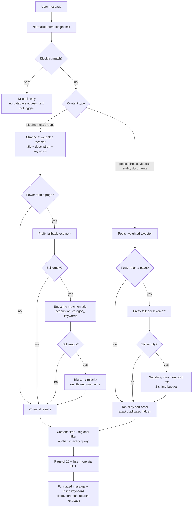

# Search

All search work happens inside PostgreSQL. The bot builds the queries
(`bot/database/queries.py`) and `SearchEngine` (`bot/services/search_engine.py`)
combines them into a result page.

## Indexing

| Column | How it is built | Weights |
|---|---|---|
| `channels.search_vector` | `BEFORE INSERT/UPDATE` trigger | title = A, description = B, category and topic keywords = C |
| `posts.search_vector` | `BEFORE INSERT/UPDATE` trigger | first 200 characters = A, rest of the text = B |
| `channels.keywords_vector` | generated column from `keywords` | — |
| `channels.title`, `channels.username` | `pg_trgm` GIN indexes | — |

Because the vectors are built by triggers, any writer — the collection pipeline,
an import or the demo seed — produces indexed rows without extra code. Ranking
uses `ts_rank` over the weighted vector, so a match in a channel title ranks
above a match in its description without hand-tuned coefficients.

**Topic keywords.** `scripts/build_channel_keywords.py` reads lexeme statistics of
each channel's posts (`ts_stat`), keeps frequent words that are rare across
channels (a document-frequency cut-off) and stores the top 20 in
`channels.keywords`. A channel can then be found by what it writes about even if
its title and description never mention it. The job runs nightly.

Both the index and the query use the PostgreSQL `russian` text-search
configuration. That choice determines what each language gets (next section).

## Languages

| Language | What works | How |
|---|---|---|
| Russian | Full stemming | Russian Snowball stemmer: "рецепт" finds "рецептов", "рецептами". |
| English | Full stemming | Latin-script words go to the English Snowball stemmer inside the same configuration: "recipe" finds "recipes". |
| Uzbek, Kazakh | Prefix matching | No stemmer exists for these languages. When exact matching returns less than one page (fewer than 10 results), the query is rebuilt with prefix lexemes (`lexeme:*`, words of 5+ characters): "yangilik" finds "yangiliklar", "жаңалық" finds "жаңалықтар". |
| Arabic | Exact word form | No stemmer; the definite article is attached to the front of a word, which prefix matching cannot strip. "وصفات" (recipes) and "الوصفات" (the recipes) are different lexemes and find different posts. |
| Any script | Typo-tolerant channel names | Trigram similarity on channel titles (`word_similarity` ≥ 0.45) and usernames (`similarity` ≥ 0.3): "tecnology digest" finds "Technology Digest". |

Other languages are indexed and match by exact word form. Typo tolerance applies
to channel names only: a trigram index over the full text of millions of posts
was evaluated and rejected because of its size and build time.

The bot interface itself is available in English and Russian.

## Query path



For the "all" view, channels are searched first; posts fill the page only when
fewer than half a page of channels was found. The media filters (photos, videos,
audio, documents) use the same post `tsvector` plus an `EXISTS` check on the
media type, never a substring scan.

## Ranking, sorting and pagination

- **Sort orders:** relevance (`ts_rank`, then members or views), views (members
  for channels), newest.
- **Result cap:** posts are ranked inside the top `MAX_RESULTS` rows of the
  active sort order. Deduplication and the final ordering run over that capped
  set, which keeps popular words cheap.
- **Exact duplicates:** posts with identical normalised text (lower-cased,
  trimmed, at least 20 characters) form one group (`md5` of the text); only the
  best-ranked post of each group is shown. Short texts are never grouped, and
  near-duplicates are not merged.
- **Pagination without `COUNT`:** a page requests `per_page + 1` rows; the extra
  row only tells whether a next page exists. There is no "N results found"
  counter, because an exact count over millions of rows is the most expensive
  part of a search.

## Filters

- **Content filter (safe search).** Each channel has a nullable 18+ flag. By
  default results exclude flagged channels and their posts; the 18+ mode shows
  only flagged ones. The two modes never mix. The collection pipeline set the
  flag from the channel's import category, but only while the flag was still
  undetermined; operators change it in the panel's labelling editor, and a manual
  decision is final and logged.
- **Regional result filter.** `HIDDEN_SECTIONS` lists `channels.section` values
  that are hidden from results. The data stays in the database; an empty value
  disables the filter.

## The substring fallback for posts

When nothing else matches, posts are searched with `text ILIKE '%…%'`. This
catches substrings inside words, hashtags and glued forms, but it cannot use an
index. It therefore runs inside a savepoint with `SET LOCAL statement_timeout`
(2 s by default, `POST_FALLBACK_TIMEOUT_MS`) and at most 200 rows: cheap hits are
still returned, an expensive scan is cancelled and the user gets "nothing
found". See [performance.md](performance.md) for the measurements behind it.

## Example

```text
$ docker compose run --rm bot python -m scripts.search_cli "yangilik"
Query: "yangilik"  type=all  sort=relevance  mode=safe search
Channels and groups (1):
  [channel] Kun yangiliklari  @teleseek_demo_kun_yangiliklari  members=31,200  category=News
Posts (5):
  ...  Kun yangiliklari: Sport yangiliklari: milliy jamoa navbatdagi o'yinda g'alaba qozondi.
  ...  Sport olami: Futbol yangiliklari: chempionatda yangi mavsum boshlandi.
  ...
-- page 1, next page: no
```

The integration tests in `tests/integration/test_demo_search.py` and
`test_multilang.py` check each behaviour described here against the synthetic
data set.
